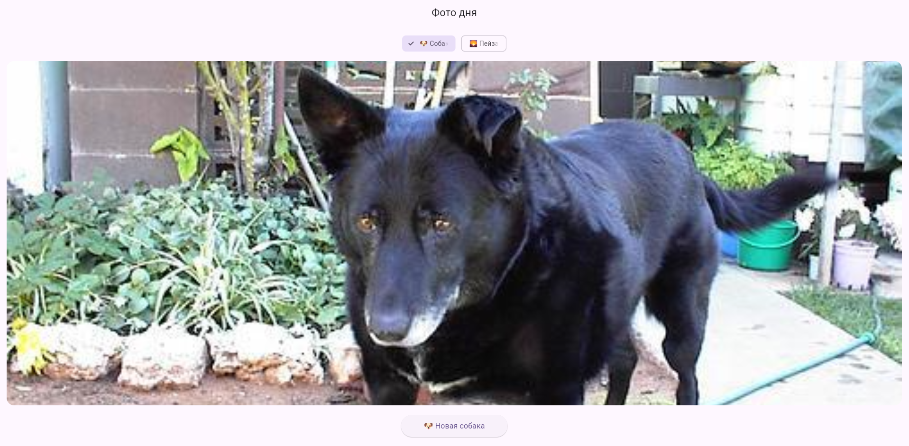

# Flutter. Лабораторная работа №8
## Информация об авторе
**ФИО** Бараков Олег Юрьевич  
**Группа** ИСП-241  
## Стек и версии
Flutter: 3.47.2  
Dart: 3.13.2  
платформа: Web (Chrome)  
пакет: http  
## Скриншот приложения

## Как запустить
1. `git clone <url>`
2. `cd photo_of_the_day`
3. `flutter pub get`
4. `flutter run -d chrome`
## Что изучили
- Future<T>
- async / await
- http.get() и jsonDecode()
## Ответы на вопросы:
1. Future<T> — это объект, который обещает вернуть значение типа T в будущем. Сейчас результата нет, но он появится позже.
Отличие от обычного возвращаемого значения обычное значение доступно сразу, а Future - только когда асинхронная операция завершится.
2. await приостанавливает выполнение функции до получения результата. Он ставится перед вызовом - подожди здесь пока Future не завершится, потом продолжи.
await не блокирует весь поток - он только приостанавливает текущую функцию. Другие части программы продолжают работать.
3. setState() дважды потому что:
В начале: сразу показываем загрузку и сбрасываем предыдущий результат
В конце: скрываем загрузку после получения результата
4. мы передаём ссылку на функцию, а не вызываем её. _fetchPhoto() со скобками вызвало бы функцию при построении виджета
5. Image.network() - загружает и отображает картинку по URL. Это синхронный виджет - Flutter сам управляет загрузкой изображения внутри.
Image.asset() - Используем полностью локальные картинки.